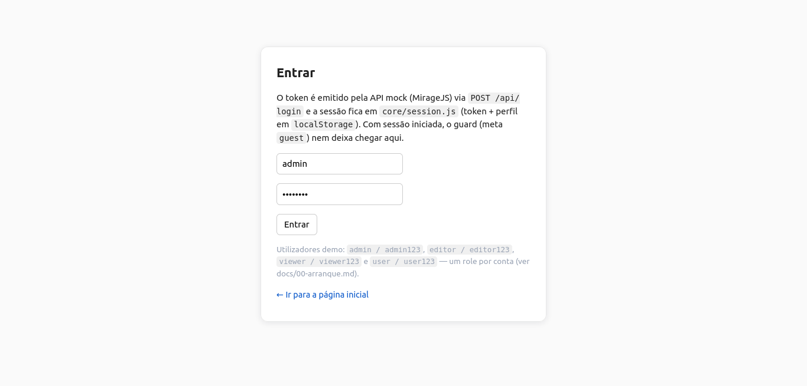
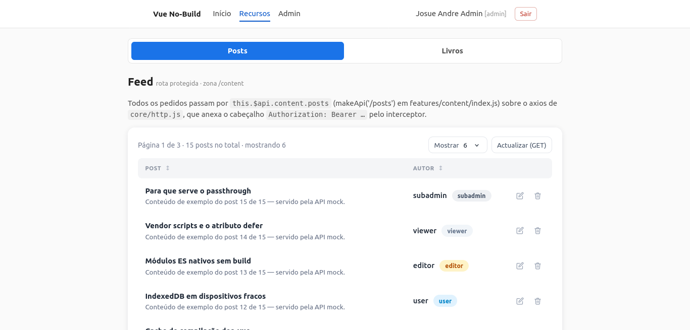
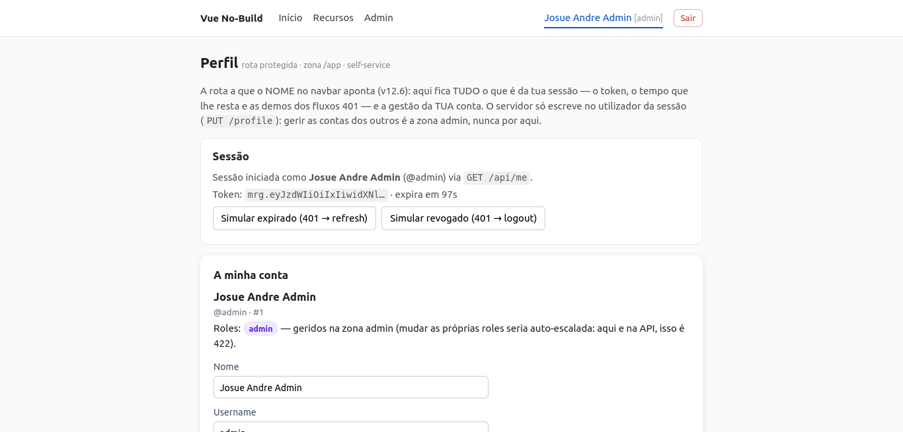

# Vue No-Build Starter Template

**Version:** v12.17.1

> **In 30 seconds:** the Vue 2 starter without a build step. Serve the folder over HTTP,
> open `index.html`, and use the MirageJS mock to explore sessions, permissions,
> CRUD, and routes without installing dependencies.

This starter is for **Vue 2.x** apps with Single File Components (`.vue`) loaded directly
in the browser. **There is no build step, Vue CLI, or Node.js requirement**: production
vendors live in `vendor/`, while native ES modules live in `src/`.

It includes server-authoritative sessions with an **access/refresh pair** (the session
registry where the token references the `jti` and carries an integrity hash; the short-lived
access token is sent with every request and the long-lived refresh token only to
`/refresh`; rotation, reuse detection, and family revocation are included), automatic
single-flight refresh, server-driven RBAC/ABAC (CASL) with an **editable, reorderable
policy** (drag and drop; the last matching rule wins), and the seeded CRUD factory in the
mock API. It also includes the **Profile** route, feature-based route areas with the single
guard, an admin sidebar layout, the complete MirageJS mock API, and the **generic table**
(`ui/DataTable.vue`) shared by posts, books, and the admin user panel. The table supports
server-side sorting and pagination, inline editing driven by `meta.editable`, sortable and
numeric columns driven by `meta.sorts`, input types and reserved fields via
`fieldTypes`/`fieldDisabled`, custom cell/action slots, and whole-set aggregates through
`meta.roleCounts`. The navbar has one link per area (`resources` combines posts and books
in sub-navigation tabs). An ADMIN account can be edited only by an admin (T12: 403 before
validation); the `update User` rule manages ordinary accounts and cannot take administrator
credentials.

JSDoc is included throughout the modules, and `jsconfig.json` provides VS Code
IntelliSense without the build step or TypeScript.

## Start in 3 steps

1. Clone the repository.
2. Serve the folder over HTTP from the **site root** (for example, with Live Server).
   `file://` does not work.
3. Open the app and sign in with `admin / admin123` or `user / user123`. Demo accounts
   also include `editor / editor123`, `viewer / viewer123`, and `subadmin / subadmin123`.

For `history` mode, the server must fall back to `index.html`. For the sub-path, set
`<base href="/">`.

Details: [`docs/00-arranque.en.md`](docs/00-arranque.en.md)

## Structure

```text
index.html  env.js    shell + vendors (defer); env.js is the ONLY deployment file
jsconfig.json          IntelliSense/JSDoc in the editor; the browser ignores this file
vendor/     vendor-dev/           production libraries vs development-only mock libraries
src/
  main.js                 composition root: mock -> router -> permissions -> services -> store
  app/                    App.vue, router.js, guards.js, services.js, and store.js
  core/                   infrastructure: config, session, ability, http, loader, cache
  ui/                     generic layouts, Ui* components, and the shared DataTable
  features/               one folder per feature; index.js is the ONLY registry
    site/  auth/  content/  admin/   (content = posts + books in one area)
dev/
  mock/                   Mirage server (index, token, sessions, helpers, crud, routes/, seeds/) — delete in production
docs/                     documentation, one file per topic
scripts/
  intrusion-matrix.mjs    T01–T12 matrix against the real code (run after every change — see guide 08)
  syntax-check.mjs        syntax checks for .vue/.js (`npm run check` runs both)
```

A component used by **one feature** stays inside that feature. A component shared by **two
or more features** belongs in `src/ui/`.

## Documentation

| Document | Topic |
| --- | --- |
| [`00-arranque.en.md`](docs/00-arranque.en.md) | startup, server, debug, and demo users |
| [`01-como-funciona.en.md`](docs/01-como-funciona.en.md) | tree, boot, layers, principles, and performance |
| [`02-nova-pagina.en.md`](docs/02-nova-pagina.en.md) | adding the page to an existing feature |
| [`03-nova-feature.en.md`](docs/03-nova-feature.en.md) | the feature contract and single registry |
| [`04-falar-com-a-api.en.md`](docs/04-falar-com-a-api.en.md) | `$api`, `$http`, and 401/403/422 |
| [`05-login-e-permissoes.en.md`](docs/05-login-e-permissoes.en.md) | sessions, guards, and CASL policy data |
| [`06-mock-api.en.md`](docs/06-mock-api.en.md) | MirageJS, seeds, and the endpoint table |
| [`07-producao.en.md`](docs/07-producao.en.md) | deployment, `env.js`, cache, and VERSIONS |
| [`08-seguranca.en.md`](docs/08-seguranca.en.md) | OWASP Top 10, route security, and session security |
| [`09-convencoes-de-rotas.en.md`](docs/09-convencoes-de-rotas.en.md) | route-area, route, and meta conventions |

## Dependencies (vendored)

Vue 2.6.12 · VueRouter 3.0.0 · Vuex 3.6.2 · VueHead 2.2.0 · vue2-sfc-loader 0.9.5 ·
Axios 1.21.0 (CVE-2025-27152 fixed) · CASL 6.7.1 · MirageJS 0.1.48 (development only).
Origin and SHA-256: [`vendor/VERSIONS.en.md`](vendor/VERSIONS.en.md).

## Screenshots







## Contributing

Feel free to **open issues** for new features or **pull requests** that add them.
