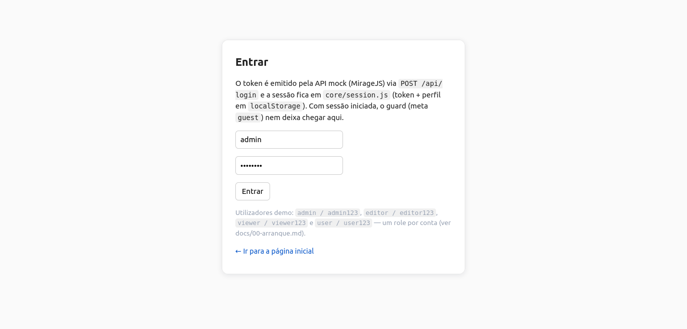
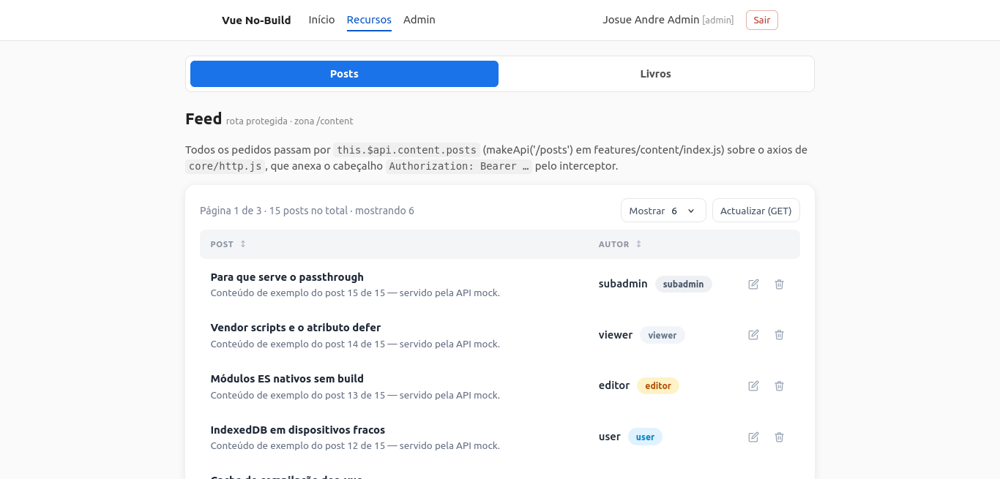
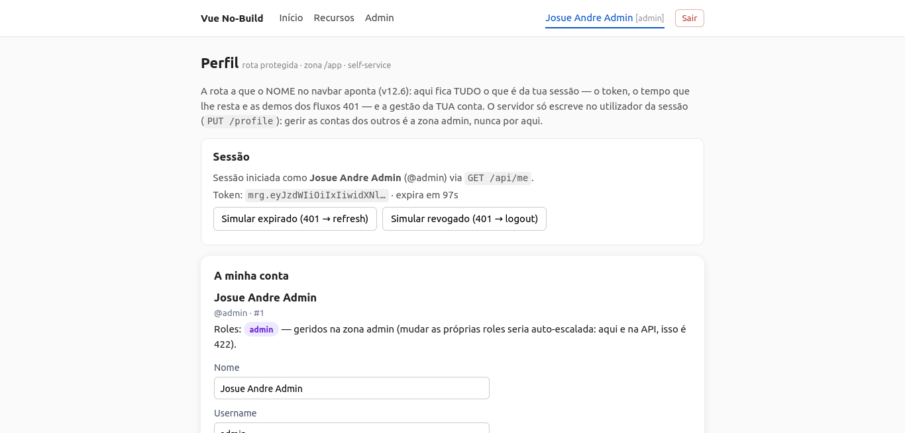

<div align="center">

# Vue No-Build Starter Template

**Português** · [English](README.en.md)

<div align="center">

 [](#)

</div>


[](https://github.com/CodeShark37/Vue-No-Build-Starter-Template/releases)

**Autor:** [Josué André](https://github.com/CodeShark37)

</div>

> [!NOTE]
> Um starter Vue 2 sem build step: servir a pasta por HTTP, abrir `index.html` e explorar
> sessões, permissões, CRUD e rotas com a API mock MirageJS.

## Índice

- [O que é este template?](#o-que-é-este-template)
- [Features](#features)
- [Instalação](#instalação)
- [Início rápido](#início-rápido)
- [Estrutura](#estrutura)
- [Documentação](#documentação)
- [Dependências](#dependências)
- [Showcase](#showcase)
- [Contribuição](#contribuição)

## O que é este template?

Um starter para aplicações **Vue 2.x** com Single File Components (`.vue`) carregados
directamente no browser. **Não existe build step, Vue-CLI ou requisito de Node.js para
servir a aplicação**: os vendors de produção vivem em `vendor/` e os módulos ES nativos
em `src/`.

## Features

- Sessões com autoridade no servidor, par access/refresh, rotação, deteção de reutilização
  e revogação por família;
- Refresh automático single-flight;
- RBAC/ABAC server-driven com CASL e política editável/reordenável;
- CRUD factory no mock para todos os recursos com seed;
- Rota de Perfil, guards de rotas e layouts por feature;
- API mock MirageJS completa;
- Matriz de intrusão T01–T12 e verificação de sintaxe.

## Instalação

### Pré-requisitos

- Um servidor HTTP local, como VS Code Live Server, `python3 -m http.server` ou `php -S localhost:8080`;
- Node.js `>=18` apenas para executar `npm run check`.

### Clonar

```bash
git clone https://github.com/CodeShark37/Vue-No-Build-Starter-Template.git
cd Vue-No-Build-Starter-Template
```

## Início rápido

1. Servir a pasta pela **raiz do site**. `file://` não funciona porque o browser bloqueia
   o carregamento dos ficheiros `.vue`.
2. Abrir a aplicação no browser.
3. Entrar com `admin / admin123` ou `user / user123`. Existem também `editor / editor123`,
   `viewer / viewer123` e `subadmin / subadmin123`.

Em `history mode`, o servidor deve fazer fallback para `index.html`. Para um sub-caminho,
definir `<base href="/">`.

Detalhes: [`docs/00-arranque.md`](docs/00-arranque.md) ·
[portal da documentação](docs/README.md)

## Estrutura

```text
├── index.html  env.js    shell + vendors (defer); env.js é o ÚNICO ficheiro do deploy
├── jsconfig.json          IntelliSense/JSDoc; não é build e o browser ignora-o
├── vendor/     vendor-dev/           libs de produção vs libs mock só de desenvolvimento
├── src/
│   ├── main.js                 composição: mock -> router -> permissões -> serviços -> store
│   ├── app/                    App.vue, router.js, guards.js, services.js, store.js
│   ├── core/                   config, session, ability, http, loader, cache
│   ├── ui/                     layouts, componentes Ui* e DataTable partilhada
│   └── features/               uma pasta por feature; index.js é o registo único
│       └── site/  auth/  content/  admin/   (content = posts + books)
├── dev/
│   └── mock/                   Mirage, tokens, sessões, CRUD, rotas e seeds — apagar em produção
├── docs/                       Documentação, um ficheiro por assunto
└── scripts/
    ├── intrusion-matrix.mjs    Matriz T01–T12 contra o código real
    └── syntax-check.mjs        Verificação de sintaxe dos .vue/.js
```

Um componente usado por **uma feature** fica dentro dela. Um componente usado por **duas
ou mais features** pertence a `src/ui/`.

## Documentação

| Documento | Conteúdo |
| --- | --- |
| [`docs/README.md`](docs/README.md) | portal e percurso recomendado |
| [`docs/00-arranque.md`](docs/00-arranque.md) | servidor, debug e utilizadores demo |
| [`docs/01-como-funciona.md`](docs/01-como-funciona.md) | árvore, boot, camadas e desempenho |
| [`docs/02-nova-pagina.md`](docs/02-nova-pagina.md) | acrescentar uma página |
| [`docs/03-nova-feature.md`](docs/03-nova-feature.md) | contrato e registo de feature |
| [`docs/04-falar-com-a-api.md`](docs/04-falar-com-a-api.md) | `$api`, `$http` e erros HTTP |
| [`docs/05-login-e-permissoes.md`](docs/05-login-e-permissoes.md) | sessões, guards e CASL |
| [`docs/06-mock-api.md`](docs/06-mock-api.md) | MirageJS, seeds e endpoints |
| [`docs/07-producao.md`](docs/07-producao.md) | deploy, `env.js` e cache |
| [`docs/08-seguranca.md`](docs/08-seguranca.md) | OWASP, rotas e sessões |
| [`docs/09-convencoes-de-rotas.md`](docs/09-convencoes-de-rotas.md) | convenções de rotas |

Todas as páginas têm uma versão inglesa correspondente.

## Dependências

- [Vue](https://github.com/vuejs/vue) `2.6.12`
- [Vue Router](https://github.com/vuejs/router) `3.0.0`
- [Vuex](https://github.com/vuejs/vuex) `3.6.2`
- [VueHead](https://github.com/ktquez/vue-head) `2.2.0`
- [vue3-sfc-loader](https://github.com/FranckFreiburger/vue3-sfc-loader) `0.9.5`
  (build para Vue 2)
- [Axios](https://github.com/axios/axios) `1.21.0`
- [CASL](https://github.com/stalniy/casl) `6.7.1`
- [MirageJS](https://github.com/miragejs/miragejs) `0.1.48`
  (apenas desenvolvimento)

Origem e SHA-256: [`vendor/VERSIONS.md`](vendor/VERSIONS.md).

## Showcase







## Contribuição

Abra **issues** para propor funcionalidades ou envie **pull requests** com melhorias.
