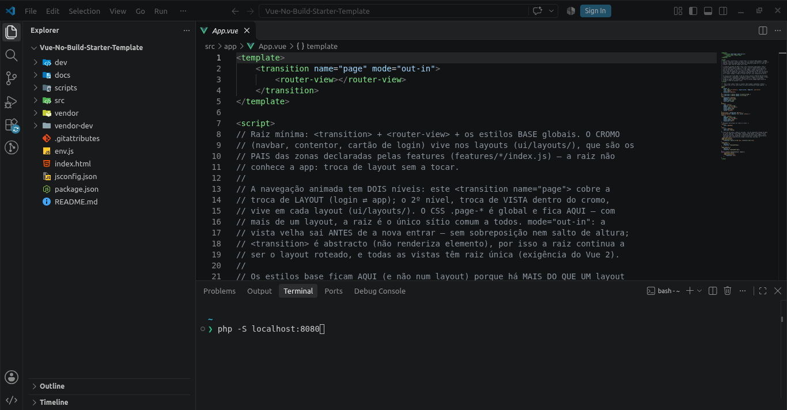

# 00 — Startup
> **Navigation:** [Portuguese README](../README.md) · [English README](../README.en.md) · [Next](01-como-funciona.en.md)

## 3 steps

1. Clone: `git clone https://github.com/CodeShark37/Vue-No-Build-Starter-Template.git`.
2. Serve the folder over HTTP from the **site root** (for example, with VS Code Live Server or
   `python3 -m http.server`). `file://` does not work because browsers block `fetch` for `.vue` files.
3. Open the app in a browser. Sign in with `admin / admin123` or `user / user123`. Other demo
   accounts are `editor / editor123`, `viewer / viewer123`, and `subadmin / subadmin123`.

## Server notes

- **`history` mode** (`src/core/config.js`): the server must fall back to `index.html` for
  unknown paths. Without that fallback, use `routerMode: 'hash'`.
- **Sub-path** (for example, `/my-repo/`): change `<base href="/">` in `index.html`. The loader
  and router use it automatically.

## Development

- **Full Vue warnings:** set `vueDebug: true` in `env.js` to use `vendor-dev/vue.dev.js` instead
  of the minified build. Do not edit `index.html`.
- **Mock on/off:** set `mock: true` or `false` in `env.js` (see [`06-mock-api.en.md`](06-mock-api.en.md)).
- **Simulated latency and token TTLs:** configure `timing`, `tokenTtl` (access: 120s), and
  `refreshTtl` (refresh: 7 days) in `src/core/config.js`.
- **Verification:** Node.js >= 18 is required. `npm run check` runs `node scripts/syntax-check.mjs`
  and `node scripts/intrusion-matrix.mjs`. `npm install` is not required; `package.json` records
  provenance rather than an installable application.

## Demo users

| Account | password | Role | Access |
| --- | --- | --- | --- |
| `admin` | `admin123` | `admin` | Everything, including `/admin/stats` and `/admin/users` |
| `user` | `user123` | `user` | `/content/posts`; owner rules allow editing and deleting only owned posts |
| `editor` | `editor123` | `editor` | `/content/posts`; can edit every author’s posts but cannot delete |
| `viewer` | `viewer123` | `viewer` | `/content/posts` and `/content/books`; read-only |
| `subadmin` | `subadmin123` | `subadmin` | `/admin/users`; can read/update ordinary `User` records, but cannot change `roles`; not `/admin/stats` or `/admin/permissions` |

The `/admin/users` panel can create accounts such as `carol / carol123`. They can sign in
immediately with their role’s permissions; no additional code is required (see
[`05-login-e-permissoes.en.md`](05-login-e-permissoes.en.md)).

## Documentation map

| Document | Topic |
| --- | --- |
| [`00-arranque.en.md`](00-arranque.en.md) | This guide |
| [`01-como-funciona.en.md`](01-como-funciona.en.md) | Tree, layers, principles, and performance |
| [`02-nova-pagina.en.md`](02-nova-pagina.en.md) | Adding a page to an existing feature |
| [`03-nova-feature.en.md`](03-nova-feature.en.md) | Adding a feature and its contract |
| [`04-falar-com-a-api.en.md`](04-falar-com-a-api.en.md) | `$api`, `$http`, and 401/403 rules |
| [`05-login-e-permissoes.en.md`](05-login-e-permissoes.en.md) | Sessions, guards, and CASL policy data |
| [`06-mock-api.en.md`](06-mock-api.en.md) | MirageJS, seeds, and endpoints |
| [`07-producao.en.md`](07-producao.en.md) | Deployment, `env.js`, removed files, and cache |
| [`08-seguranca.en.md`](08-seguranca.en.md) | OWASP Top 10 and T01–T12 intrusion matrix |
| [`09-convencoes-de-rotas.en.md`](09-convencoes-de-rotas.en.md) | Route-area, route, and META conventions |
