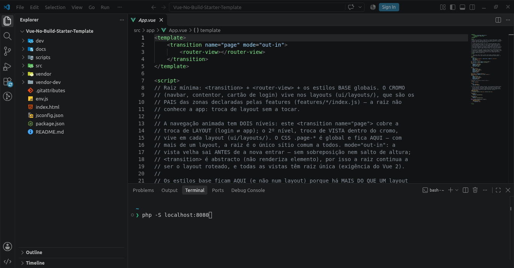

# 00 — Arranque
> **Navegação:** [README português](../README.md) · [README english](../README.en.md) · [Seguinte](01-como-funciona.md) · [English](00-arranque.en.md)

## 3 passos

1. Clonar: `git clone https://github.com/CodeShark37/Vue-No-Build-Starter-Template.git`
2. Servir a pasta por HTTP a partir da **raiz do site** (ex.: VS Code Live Server, `python3 -m http.server`). `file://` não funciona: os browsers bloqueiam o `fetch` dos `.vue`.
3. Abrir no browser. Entrar com `admin / admin123` (role admin) ou `user / user123` (role user) — há também `editor / editor123`, `viewer / viewer123` e `subadmin / subadmin123`.

## Notas de servidor

- **Modo `history`** (o padrão em `src/core/config.js`): o servidor tem de fazer *fallback* para `index.html` nos caminhos desconhecidos. Sem esse fallback, pôr `routerMode: 'hash'`.
- **Sub-caminho** (ex.: `/my-repo/`): mudar `<base href="/">` no `index.html`; tudo o resto (loader, router) segue-o automaticamente.

## Desenvolvimento

- **Avisos completos do Vue**: `vueDebug: true` em `env.js` (usa `vendor-dev/vue.dev.js` em vez do minificado — não se toca no `index.html`).
- **Mock on/off**: `mock: true/false` em `env.js` (ver [`06-mock-api.md`](06-mock-api.md)).
- **Latência simulada / TTLs dos tokens**: `timing`, `tokenTtl` (access, 120s) e `refreshTtl` (refresh, 7 dias) em `src/core/config.js`.
- **Verificação**: requer Node.js >= 18; `npm run check` = `node scripts/syntax-check.mjs` + `node scripts/intrusion-matrix.mjs` (só um atalho; `npm install` não é preciso para correr nada — o `package.json` é proveniência, não instalação).

## Utilizadores demo

| Conta | Password | Role | Vê |
| --- | --- | --- | --- |
| `admin` | `admin123` | `admin` | tudo, incl. `/admin/stats` e `/admin/users` |
| `user` | `user123` | `user` | `/content/posts` (owner rules: edita/apaga só os próprios posts) e `/content/books` (leitura), sem link para o admin |
| `editor` | `editor123` | `editor` | `/content/posts` — edita posts de TODOS os autores (update sem conditions), não apaga — e `/content/books` (leitura). A diferença para `user` está na ESCRITA de posts, não na leitura |
| `viewer` | `viewer123` | `viewer` | `/content/posts` e `/content/books` — só leitura: nenhum botão, nenhum formulário |
| `subadmin` | `subadmin123` | `subadmin` | `/admin/users` — gere contas COMUNS (read+update `User`; `roles` reservado ao admin), sem `/admin/stats` nem `/admin/permissions` |

O painel `/admin/users` cria contas novas (ex.: `carol / carol123`): entram logo, com as permissões do role — zero código extra (ver [`05-login-e-permissoes.md`](05-login-e-permissoes.md)).

## Mapa da documentação

| Doc | Assunto |
| --- | --- |
| [`00-arranque.md`](00-arranque.md) | Este ficheiro |
| [`01-como-funciona.md`](01-como-funciona.md) | Árvore, camadas, doutrinas e desempenho |
| [`02-nova-pagina.md`](02-nova-pagina.md) | Acrescentar uma página a uma feature existente |
| [`03-nova-feature.md`](03-nova-feature.md) | Acrescentar uma feature nova (o contrato) |
| [`04-falar-com-a-api.md`](04-falar-com-a-api.md) | `$api` por feature, `$http`, regras de 401/403 |
| [`05-login-e-permissoes.md`](05-login-e-permissoes.md) | Sessão, guard, política CASL como dado |
| [`06-mock-api.md`](06-mock-api.md) | MirageJS, seeds, endpoints completos |
| [`07-producao.md`](07-producao.md) | Deploy: `env.js`, o que apagar, cache |
| [`08-seguranca.md`](08-seguranca.md) | Auditoria OWASP Top 10, matriz de intrusão T01–T13 |
| [`09-convencoes-de-rotas.md`](09-convencoes-de-rotas.md) | Convenção de zonas/rotas/meta e o estudo por trás |
